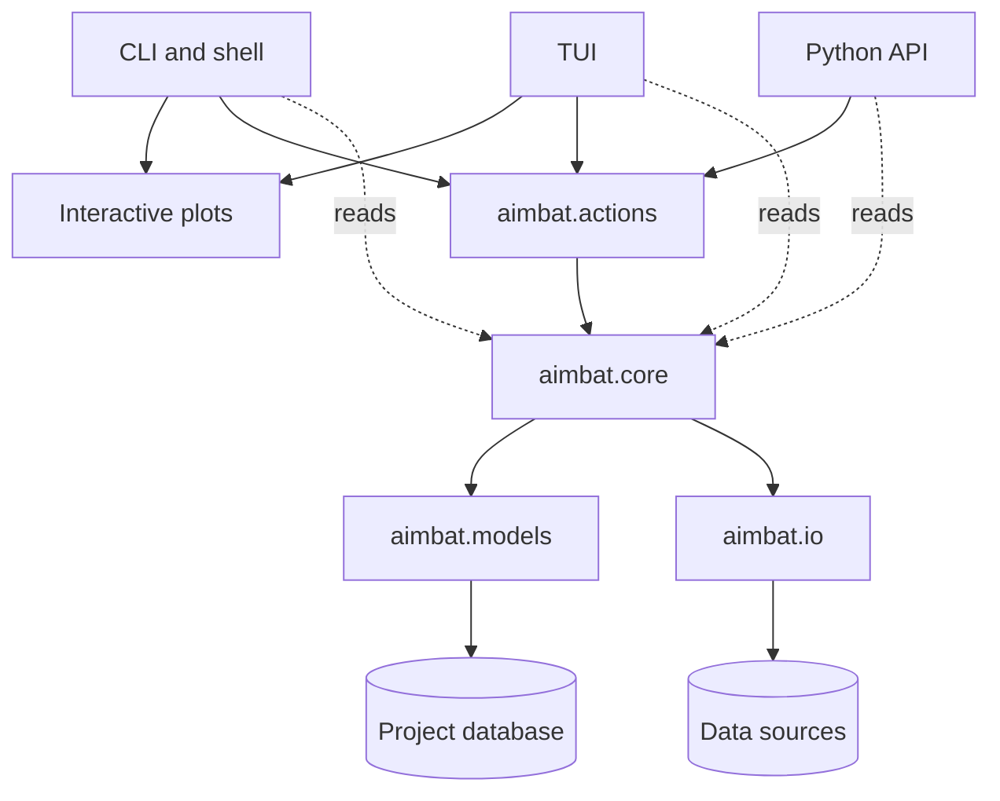

# Architecture

## Overview

The seismological algorithms that AIMBAT relies on are provided by [`pysmo`][],
among them [`ICCS`][pysmo.tools.iccs] and [`MCCC`][pysmo.tools.signal.mccc].
AIMBAT supplies the workflow around them. It stores the parameters and picks
that are their inputs, keeps the quality metrics they produce, and records
snapshots from which earlier states can be restored. A new algorithm therefore
normally belongs in pysmo, with AIMBAT making it available.

The state of a project is held in a single database: events, stations,
seismograms, their parameters, quality metrics and snapshots (see
[Database models](database-models.md)). Waveforms are not stored in the
database. Each seismogram references a data source, from which its waveform is
read when needed.

ICCS and MCCC are run through [`aimbat.core`][aimbat.core]. It builds an ICCS
instance for an event from the stored parameters, and stores each result
together with a fingerprint of the parameters it was computed from (see
[Quality validity](quality-validity.md)).

## Layers

AIMBAT is organised in layers. The interfaces form the top layer. Below them,
[`aimbat.actions`][aimbat.actions] provides complete user actions, and
[`aimbat.core`][aimbat.core] provides the building blocks that operate on the
database. The [API reference](../api/aimbat.md) documents each package.

## Actions and core

Functions in [`aimbat.core`][aimbat.core] take a session as their first
argument. They modify records and flush, but never commit.

Each function in [`aimbat.actions`][aimbat.actions] defines an atomic unit of
change, corresponding to one user action. It opens a session, validates its
input, calls one or more `core` functions, commits once, and clears any cached
state that the change has made out of date. If any step fails, nothing is
committed, so an action that takes several records changes either all of them or
none.

!!! note "Why two layers?"

    A user action often combines several operations, for example a parameter change
    followed by the restoration of quality values from a snapshot. If each operation
    committed, a failure part way through would leave the project half changed.
    Keeping commits out of `core` allows operations to be combined freely, and
    leaves the action to define the unit that is committed and the caches that are
    cleared.

Neither layer stores a selected event. Functions that act on an event take its
ID as an argument, and each interface determines the ID it passes. The
interfaces write only through actions, and so never manage sessions, commits or
caches themselves. The same holds for a script that uses actions, which makes
actions the safe default for scripts.

!!! warning "Writing through `aimbat.core`"

    A script that uses the Python API may also write through `aimbat.core` directly.
    The script then takes on what an action otherwise guarantees:

    - Changes are lost unless the script commits them, and a commit part way through
        a sequence of operations leaves the project half changed.
    - Input is not validated beforehand, so an invalid ID may only be detected after
        other records in the session have been modified.
    - A cached ICCS instance is not discarded when its event is deleted, or when
        storing values taken from it fails. The instance may then hold values that
        are not in the database.

Reads may call `core` directly, since they modify nothing. The exception is a
read that builds an ICCS instance. Building one stores CC values, so it goes
through [`prepare_iccs`][aimbat.actions.prepare_iccs].

An interface that changes values outside the database stores them through an
action afterwards. The picking tools, for example, apply new values to the
cached ICCS instance while the plot is open, and return them when the window
closes. If storing them fails, the cached instance is discarded, so that it
never holds values the database rejected.

A new feature typically comprises a `core` function that performs the work, an
action that wraps it in a transaction, and an interface that calls the action.

## Caches

AIMBAT keeps two caches in memory for the lifetime of a process: built ICCS
instances, and waveform arrays read from data sources. In the CLI, both are
empty at the start of each command. In the shell and the TUI, they persist
between commands.

A cached ICCS instance is reused only while the parameters it was built from are
unchanged (see [Quality validity](quality-validity.md)). It is discarded when
the transaction that built it rolls back, and when an action deletes its event.
A cached waveform is discarded when its data source changes on disk.

## Input and output

[`aimbat.io`][aimbat.io] reads and writes data sources. Each data type registers
the operations it supports with the decorators of `aimbat.io`, for example
creating stations, events and seismograms from a data source, reading a
waveform, or writing one. A data type need not support every operation. A new
data type is added as a member of [`DataType`][aimbat.io.DataType], together
with the functions it registers.

### Waveform writes

AIMBAT does not modify waveforms in normal use. They are written only when a
script assigns [`AimbatSeismogram.data`][aimbat.models.AimbatSeismogram.data],
and only for data types that support writing. For any other data type, the
assignment raises an error.

Assigning new data does not change the data source straight away. The data
source is changed only when the script commits its session, together with the
changes to the database. If the session is rolled back or closed without a
commit, the data source is left untouched.

Writing the data source and committing the database nevertheless remain two
separate operations, which cannot be combined into a single atomic change. The
data source is written first, so if the database commit then fails, the new
waveform remains in the data source.
