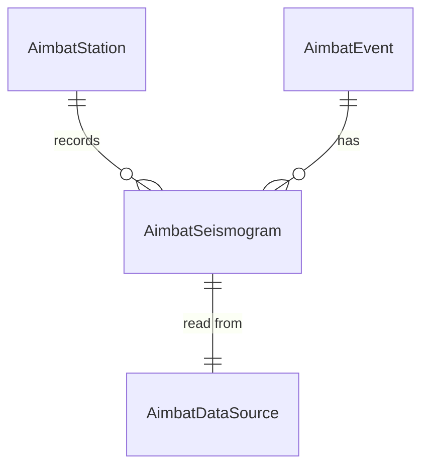
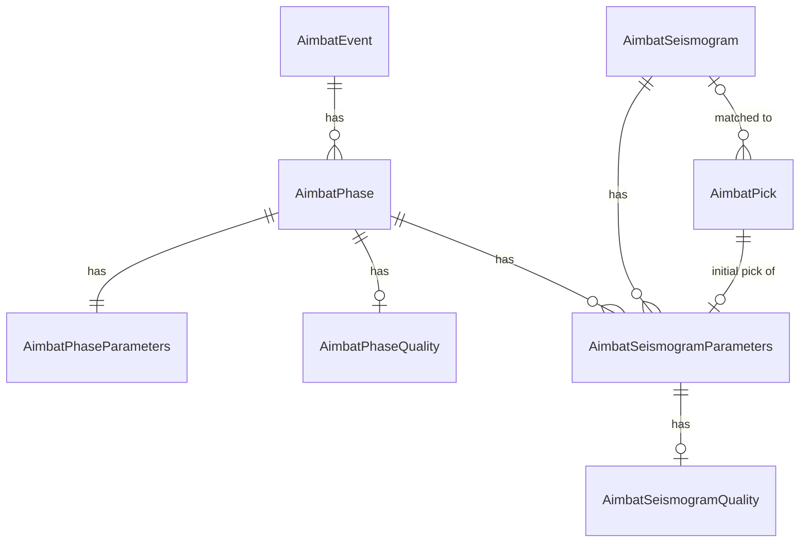
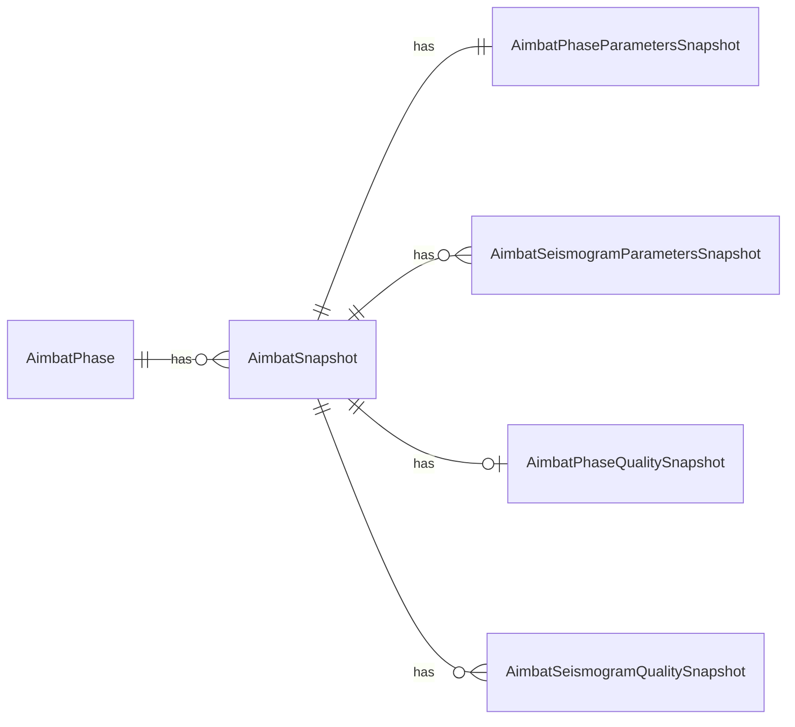
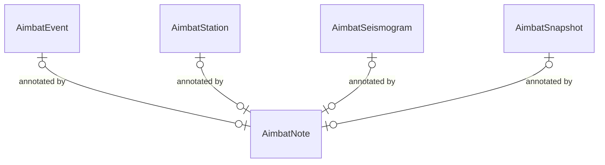

# Database models

A project is a single SQLite database. Its tables are defined as SQLModel
classes in [`aimbat.models`][aimbat.models], where each column is documented.
This page describes how the tables relate to one another. All primary keys are
UUIDs.

## Events, stations and seismograms

- An event is identified by its origin time, which is unique within a project.
- A seismogram belongs to exactly one event and one station.
- `AimbatDataSource` records where the waveform of a seismogram is stored and in
    which format. A data source is used by one seismogram only, which a unique
    index enforces.

## Phases and picks

- A phase (`AimbatPhase`) is the unit of processing: one phase of one event,
    such as P or PKP. Its name is unique within the event. Parameters, quality
    metrics and snapshots belong to a phase, not to the event.
- `AimbatSeismogramParameters` holds the processing state of one seismogram for
    one phase. A row exists only where the seismogram has an initial pick for the
    phase, and the pair of seismogram and phase is unique.
- `AimbatPick` is an initial pick as it was read or entered: its time, the label
    it was read with, the phase name assigned to it, its source, and the target it
    was read with. A pick that is named and matched to a seismogram becomes the
    initial pick of the seismogram's row for that phase. A pick is the initial
    pick of at most one row, and its time never changes.

Deletes cascade down the ownership tree. Deleting an event removes its
seismograms, phases, unmatched picks and notes. Deleting a phase removes its
parameters, quality metrics, rows and snapshots, and leaves the seismograms and
picks. Deleting a station removes its seismograms. Deleting a seismogram removes
its data source, its rows in every phase, the picks matched to it and its note.
Deleting a pick removes the row it is the initial pick of.

## Parameters and quality

- Every phase has exactly one parameter row, created together with it. A unique
    index on the foreign key enforces the one-to-one link.
- The seismogram parameter `refined_pick` is the refined pick. While it is empty,
    the initial pick is used in its place.
- A seismogram quality row belongs to one row of `AimbatSeismogramParameters`.
    It is created when an ICCS instance is first built for the phase. A phase
    quality row is created when MCCC results are first stored, either by an MCCC
    run or by restoring a snapshot.
- Quality rows store `iccs_fingerprint` and `mccc_fingerprint`, digests of the
    parameters the values were computed from, and `mccc_members`, the
    seismograms that took part in the MCCC run. A stored value is reported only
    while its fingerprint matches the current parameters. See
    [Quality validity](quality-validity.md).

The meaning of each parameter is described in
[Parameters](../usage/parameters.md).

!!! warning "Reading quality values directly"

    The quality columns hold the last computed values, including values that no
    longer apply. A query that reads them directly therefore also returns
    out-of-date values. [`Validity`][aimbat.core.Validity] determines which stored
    values still match the current parameters (see the
    [Quality analysis recipe](../usage/recipes/quality-analysis.md)).

### Base, live and snapshot classes

Each of the four kinds of row (phase parameters, seismogram parameters, phase
quality and seismogram quality) is defined by three classes. A base class
declares the fields, and a live table and a snapshot table both inherit from it.
For phase parameters, these are `AimbatPhaseParametersBase`,
`AimbatPhaseParameters` and `AimbatPhaseParametersSnapshot`.

A field added to a base class therefore appears in both the live table and the
snapshot table. The fingerprint columns are declared on the live tables only, so
snapshots do not store them.

## Snapshots

- A snapshot numbers itself within its phase by `sequence`, in the order the
    snapshots were taken. The pair `(phase_id, sequence)` is unique.
- `iccs_hash` is the instance digest of the phase when the snapshot was taken,
    and `mccc_hash` the MCCC digest of the run it froze. `mccc_hash` is empty if
    the snapshot froze no MCCC results.
- A snapshot does not freeze initial picks.
- A snapshot freezes only quality values that are valid when it is taken. An
    invalid value is stored as empty, and a quality snapshot row is omitted when
    none of its values are valid.
- Each snapshot row also links to the live row it copied. That link is set to
    null, not cascaded, when the live row is deleted, so deleting a seismogram
    leaves earlier snapshots intact. The seismogram-level snapshot tables keep
    their own `seismogram_id`, without a foreign key, for the same reason.
- Deleting a snapshot removes its rows and its note.

## Notes

A note belongs to exactly one event, station, seismogram or snapshot, which a
`CHECK` constraint enforces. A partial unique index on each foreign key limits
each record to one note. A note is deleted together with the record it belongs
to.
