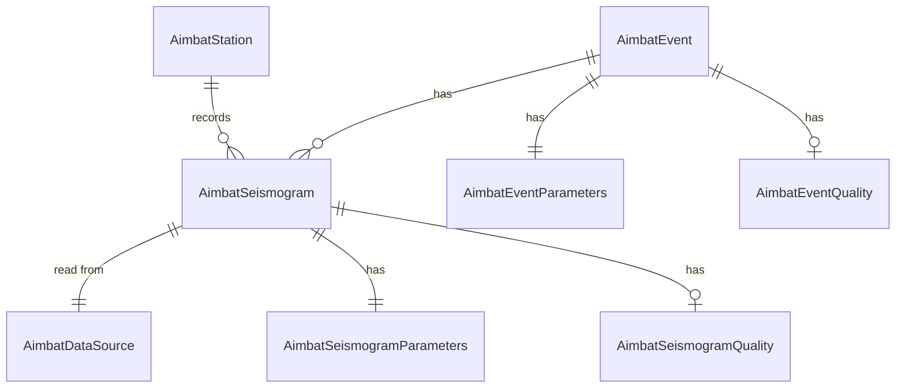
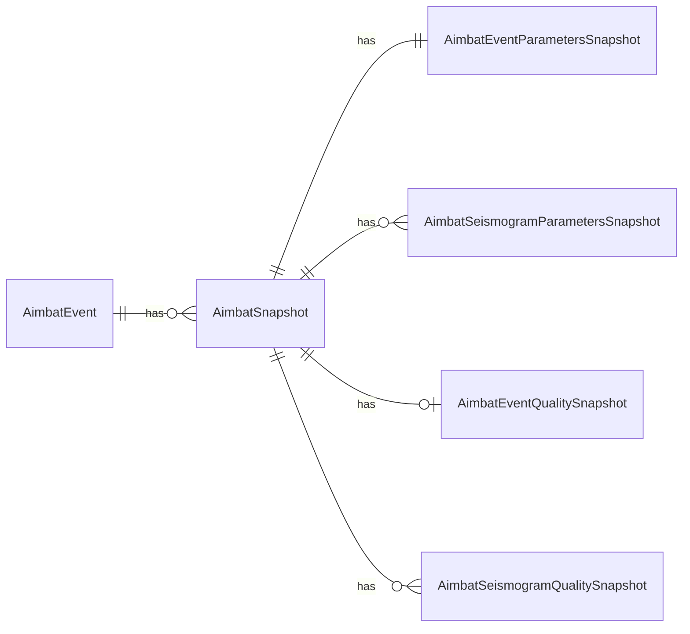
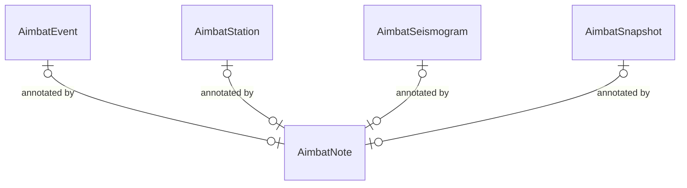

# Database models

A project is a single SQLite database. Its tables are defined as SQLModel
classes in [`aimbat.models`][aimbat.models], where each column is documented.
This page describes how the tables relate to one another. All primary keys are
UUIDs.

## Events, stations and seismograms

- An event is identified by its origin time, which is unique within a project.
- A seismogram belongs to exactly one event and one station. Its `t0` is the
    initial pick, set when the data are added.
- `AimbatDataSource` records where the waveform of a seismogram is stored and in
    which format. A data source is used by one seismogram only.

Deletes cascade down the ownership tree. Deleting an event removes its
seismograms, parameters, quality metrics, snapshots and notes. Deleting a
station removes its seismograms. Deleting a seismogram removes its data source,
parameters, quality metrics and note.

## Parameters and quality

- Every event and every seismogram has exactly one parameter row, created
    together with it. A unique index on the foreign key enforces the one-to-one
    link. The seismogram parameter `t1` is the refined pick. While it is empty,
    `t0` is used in its place.
- A seismogram quality row is created when an ICCS instance is first built for
    its event. An event quality row is created when MCCC results are first
    stored, either by an MCCC run or by restoring a snapshot.
- Quality rows store `iccs_fingerprint` and `mccc_fingerprint`, digests of the
    parameters the values were computed from, and `mccc_members`, the
    seismograms that took part in the MCCC run. A stored value is reported only
    while its fingerprint matches the current parameters. See
    [Quality validity](quality-validity.md).

The meaning of each parameter is described in
[Parameters](../usage/parameters.md).

!!! warning "Reading quality values directly"

    The quality columns hold the last computed values, including values that no
    longer apply. A query that reads them directly therefore also returns
    out-of-date values. [`Validity`][aimbat.core.Validity] determines which stored
    values still match the current parameters (see the
    [Quality analysis recipe](../usage/recipes/quality-analysis.md)).

### Base, live and snapshot classes

Each of the four kinds of row (event parameters, seismogram parameters, event
quality and seismogram quality) is defined by three classes. A base class
declares the fields, and a live table and a snapshot table both inherit from it.
For event parameters, these are `AimbatEventParametersBase`,
`AimbatEventParameters` and `AimbatEventParametersSnapshot`.

A field added to a base class therefore appears in both the live table and the
snapshot table. The fingerprint columns are declared on the live tables only, so
snapshots do not store them.

## Snapshots

- A snapshot numbers itself within its event by `sequence`, in the order the
    snapshots were taken. The pair `(event_id, sequence)` is unique.
- `iccs_hash` is the instance digest of the event when the snapshot was taken,
    and `mccc_hash` the MCCC digest of the run it froze. `mccc_hash` is empty if
    the snapshot froze no MCCC results.
- A snapshot freezes only quality values that are valid when it is taken. An
    invalid value is stored as empty, and a quality snapshot row is omitted when
    none of its values are valid.
- Each snapshot row also links to the live row it copied. That link is set to
    null, not cascaded, when the live row is deleted, so deleting a seismogram
    leaves earlier snapshots intact. The seismogram-level snapshot tables keep
    their own `seismogram_id`, without a foreign key, for the same reason.
- Deleting a snapshot removes its rows and its note.

## Notes

A note belongs to exactly one event, station, seismogram or snapshot, which a
`CHECK` constraint enforces. A partial unique index on each foreign key limits
each record to one note. A note is deleted together with the record it belongs
to.
